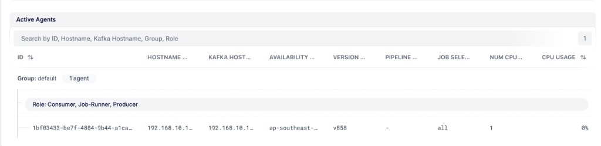

# WarpStream AWS DEV Test Setup (EKS + Agents)

## Purpose

Stands up a WarpStream cluster in an EKS cluster. The WarpStream official repo has a better guide that does so via Terraform, but I know some people might not use TF so hence my repo below. https://github.com/warpstreamlabs/terraform-aws-warpstream-eks. 

1. Create an S3 bucket for WarpStream object storage
2. Create an EKS cluster with an OIDC identity provider
3. Add an S3 VPC gateway endpoint (keeps Agent↔S3 traffic on the AWS network; avoids NAT / public S3 data-transfer charges)
4. Create an IAM role for service accounts (IRSA) and grant it S3 access
5. Create a BYOC virtual cluster in the WarpStream console
6. Deploy WarpStream Agents with Helm
7. Confirm Agents show as running in the WarpStream console

Interface VPC endpoints (e.g. private link to other AWS APIs), multi-AZ production sizing, and disaster recovery are out of scope.

## Prerequisites

Install tools on macOS with Homebrew, then authenticate to AWS and confirm access to the WarpStream console.

```bash
# AWS CLI v2
brew install awscli
aws --version

# eksctl (simplest path for a disposable DEV cluster)
brew install eksctl
eksctl version

# kubectl
brew install kubectl
kubectl version --client

# Helm v3.6+
brew install helm
helm version
```

Authenticate to the target AWS account (`aws login` or your org's SSO/login flow), then verify:

```bash
aws login   # or: aws sso login / your org's equivalent
aws sts get-caller-identity
aws configure get region || true
```

Also need access to [console.warpstream.com](https://console.warpstream.com).

## Target environment

| Resource | Value |
|---|---|
| AWS region (data plane) | `ap-southeast-1` (Singapore) |
| WarpStream control plane region | `ap-southeast-1` |
| S3 bucket | `ws-dev-apse1-<suffix>` |
| IAM role | `warpstream-agent-dev-<suffix>` |
| EKS cluster | `eks-warpstream-dev-<suffix>` |
| Kubernetes namespace | `warpstream` |
| Kubernetes service account | `warpstream-agent` |
| Access | IRSA role with S3 Put/Get/Delete/List + GetLifecycleConfiguration |
| Networking | S3 VPC **gateway** endpoint on the EKS VPC (no S3-via-NAT transfer cost) |
| Bucket URL | `s3://ws-dev-apse1-<suffix>?region=ap-southeast-1` |

If you already created the S3 bucket + IAM role, reuse those names and skip the matching sections.

## Load resource names

**Only `OWNER_EMAIL` needs editing up front** — everything else is a default for this Singapore DEV path (or derived automatically). `WS_AGENT_KEY` and `WS_VIRTUAL_CLUSTER_ID` stay blank until Part C.

```bash
cp resources.example.txt resources.txt
# Edit resources.txt: set OWNER_EMAIL="your_email_here"
source resources.txt
```

Confirm the printed values look right (`OWNER_EMAIL`, `BUCKET`, `ACCOUNT_ID`, etc.). Re-`source resources.txt` in any new terminal before continuing.

## Part A — Object storage and IAM

### 1. Create the S3 bucket

```bash
aws s3api create-bucket \
  --bucket "$BUCKET" \
  --region "$AWS_REGION" \
  --create-bucket-configuration LocationConstraint="$AWS_REGION"

aws s3api put-bucket-tagging \
  --bucket "$BUCKET" \
  --tagging "TagSet=[
    {Key=purpose,Value=warpstream-data-plane},
    {Key=environment,Value=dev},
    {Key=disposable,Value=true},
    {Key=owner_email,Value=${OWNER_EMAIL}}
  ]"
```

### Bucket settings (why these matter)

WarpStream Agents write and delete objects in this bucket as part of normal cluster operation (segments, compaction, retention). The control plane / Agents own **when** data is kept or removed — that is the product’s retention model. Do not layer a second lifecycle policy on top (for example S3 lifecycle rules that expire or transition Agent data, or MFA-delete / “soft delete” retention that keeps deleted keys around). Those fight WarpStream’s own deletes and can leave stale objects, inflate cost, or break expected retention.

Same idea for **versioning**: leave it **unconfigured** (do not enable it). Do **not** run `put-bucket-versioning Status=Suspended` on a new bucket either — that puts the bucket into a versioning-configured state, so later deletes leave **delete markers** that block `aws s3 rb --force` with `BucketNotEmpty`. If versioning is `Enabled`, every overwrite/delete also keeps prior versions and fights WarpStream’s retention model. Soft-delete / object-lock style retention has the same problem for this data path.

**Public access** should stay fully blocked. This bucket holds cluster data; Agents reach it with IAM (IRSA), not anonymous or public URLs. BlockPublic* settings below are the default hardening for that.

One lifecycle rule *is* useful and safe: abort incomplete multipart uploads (below). That only cleans up failed/partial uploads, not live WarpStream objects.

```bash
aws s3api put-public-access-block \
  --bucket "$BUCKET" \
  --public-access-block-configuration \
    BlockPublicAcls=true,IgnorePublicAcls=true,BlockPublicPolicy=true,RestrictPublicBuckets=true
```

Abort incomplete multipart uploads after 7 days so failed uploads do not accumulate:

```bash
aws s3api put-bucket-lifecycle-configuration \
  --bucket "$BUCKET" \
  --lifecycle-configuration '{
    "Rules": [
      {
        "ID": "abort-incomplete-multipart-7d",
        "Status": "Enabled",
        "Filter": { "Prefix": "" },
        "AbortIncompleteMultipartUpload": { "DaysAfterInitiation": 7 }
      }
    ]
  }'
```

### 2. Bucket URL

`BUCKET_URL` is set automatically when you `source resources.txt` (derived from `BUCKET` + `AWS_REGION`). No extra step.

After the first successful `source`, pin `SUFFIX="..."` in `resources.txt` (replace the `openssl` line) so a later re-source keeps the same bucket name and URL.

## Part B — EKS with IRSA

### 3. Create the EKS cluster

This step takes a while. `eksctl` provisions a CloudFormation stack (control plane, node group, networking) and will sit on **waiting for CloudFormation stack** for roughly **10–20+ minutes**. That is normal — leave the command running until it finishes.

Small DEV cluster sized for low throughput (~4 MiB/s). One `m5.large` node (2 vCPU / 8 GiB) is enough for a single downsized Agent.

Durability comes from S3 (multi-AZ), not from Agent count — Agents are stateless compute. Use one Agent for this DEV / cost-sensitive test; scale Agents later only if you need more produce/fetch capacity or Agent HA.

```bash
eksctl create cluster \
  --name "$EKS_NAME" \
  --region "$AWS_REGION" \
  --nodes 1 \
  --node-type m5.large \
  --with-oidc \
  --tags "purpose=warpstream-data-plane,environment=dev,disposable=true,owner_email=${OWNER_EMAIL}"
```

**Done when** the command exits `0` and the last success line looks like:

```text
[✔]  EKS cluster "eks-warpstream-dev-<suffix>" in "ap-southeast-1" region is ready
```

Along the way you should also see control-plane CloudFormation finish, addons created (`vpc-cni`, `kube-proxy`, `coredns`), OIDC associated, the managed nodegroup stack complete, and kubeconfig written. Repeating `waiting for CloudFormation stack` alone means it is still in progress — not failed.

Quick check after it finishes:

```bash
aws eks describe-cluster --name "$EKS_NAME" --region "$AWS_REGION" --query 'cluster.status' --output text
# ACTIVE
```

Confirm the cluster is reachable and OIDC is enabled:

```bash
aws eks update-kubeconfig --region "$AWS_REGION" --name "$EKS_NAME"
kubectl get nodes

OIDC_ISSUER="$(
  aws eks describe-cluster \
    --name "$EKS_NAME" \
    --region "$AWS_REGION" \
    --query "cluster.identity.oidc.issuer" \
    --output text
)"
OIDC_ID="${OIDC_ISSUER##*/}"

echo "OIDC_ISSUER=$OIDC_ISSUER"
echo "OIDC_ID=$OIDC_ID"
```

If you created the cluster without `--with-oidc`, associate the IAM OIDC provider:

```bash
eksctl utils associate-iam-oidc-provider \
  --cluster "$EKS_NAME" \
  --region "$AWS_REGION" \
  --approve
```

At this point you only have AWS infra ready (S3 + EKS). Confirm the EKS cluster is `ACTIVE` / nodes are up via AWS or `kubectl` if you want — nothing WarpStream-related exists in the console yet (BYOC cluster + Agents come later in Part C).

### 4. Add an S3 VPC gateway endpoint (recommended — avoids S3 data-transfer cost)

Without a gateway endpoint, Agent traffic to S3 typically leaves the VPC via a NAT gateway (or the public internet). That path incurs **NAT data-processing and/or S3 data-transfer charges**. An **S3 VPC gateway endpoint** keeps `s3://` traffic on the AWS private network.

Notes:

- Gateway endpoints for S3 are **free** (no hourly or per-GB endpoint charge).
- They work for the regional S3 endpoint used by the Agents (`s3.${AWS_REGION}.amazonaws.com` / path-style / virtual-hosted).
- Attach the endpoint to the **route tables** used by the EKS node subnets so every node reaches S3 privately.

Create the endpoint after the cluster exists (so the VPC and subnet route tables are known):

```bash
VPC_ID="$(
  aws eks describe-cluster \
    --name "$EKS_NAME" \
    --region "$AWS_REGION" \
    --query "cluster.resourcesVpcConfig.vpcId" \
    --output text
)"

# Subnets used by the cluster (control plane + nodes)
SUBNET_IDS="$(
  aws eks describe-cluster \
    --name "$EKS_NAME" \
    --region "$AWS_REGION" \
    --query "cluster.resourcesVpcConfig.subnetIds" \
    --output text
)"

# Unique route table IDs associated with those subnets
ROUTE_TABLE_IDS="$(
  for subnet in $SUBNET_IDS; do
    aws ec2 describe-route-tables \
      --region "$AWS_REGION" \
      --filters "Name=association.subnet-id,Values=${subnet}" \
      --query "RouteTables[].RouteTableId" \
      --output text
  done | tr '\t' '\n' | sort -u | tr '\n' ' '
)"

# Fall back to the VPC main route table if a subnet has no explicit association
if [ -z "$(echo "$ROUTE_TABLE_IDS" | tr -d '[:space:]')" ]; then
  ROUTE_TABLE_IDS="$(
    aws ec2 describe-route-tables \
      --region "$AWS_REGION" \
      --filters "Name=vpc-id,Values=${VPC_ID}" "Name=association.main,Values=true" \
      --query "RouteTables[].RouteTableId" \
      --output text
  )"
fi

echo "VPC_ID=$VPC_ID"
echo "ROUTE_TABLE_IDS=$ROUTE_TABLE_IDS"

# Skip if an S3 gateway endpoint already exists in this VPC
EXISTING_S3_VPCE="$(
  aws ec2 describe-vpc-endpoints \
    --region "$AWS_REGION" \
    --filters \
      "Name=vpc-id,Values=${VPC_ID}" \
      "Name=service-name,Values=com.amazonaws.${AWS_REGION}.s3" \
      "Name=vpc-endpoint-type,Values=Gateway" \
    --query "VpcEndpoints[0].VpcEndpointId" \
    --output text
)"

if [ "$EXISTING_S3_VPCE" != "None" ] && [ -n "$EXISTING_S3_VPCE" ]; then
  S3_VPCE_ID="$EXISTING_S3_VPCE"
  echo "Reusing existing S3 gateway endpoint: $S3_VPCE_ID"
else
  S3_VPCE_ID="$(
    aws ec2 create-vpc-endpoint \
      --region "$AWS_REGION" \
      --vpc-id "$VPC_ID" \
      --vpc-endpoint-type Gateway \
      --service-name "com.amazonaws.${AWS_REGION}.s3" \
      --route-table-ids $ROUTE_TABLE_IDS \
      --tag-specifications "ResourceType=vpc-endpoint,Tags=[
        {Key=Name,Value=${EKS_NAME}-s3},
        {Key=purpose,Value=warpstream-data-plane},
        {Key=environment,Value=dev},
        {Key=disposable,Value=true},
        {Key=owner_email,Value=${OWNER_EMAIL}}
      ]" \
      --query "VpcEndpoint.VpcEndpointId" \
      --output text
  )"
  echo "Created S3 gateway endpoint: $S3_VPCE_ID"
fi

# Confirm a prefix-list route for S3 is present on each route table
for rt in $ROUTE_TABLE_IDS; do
  aws ec2 describe-route-tables \
    --region "$AWS_REGION" \
    --route-table-ids "$rt" \
    --query "RouteTables[0].Routes[?GatewayId=='${S3_VPCE_ID}']" \
    --output table
done
```

**Done when** you see a VPC / route-table echo, a create-or-reuse line with a `vpce-...` id, and each route table shows an S3 prefix-list route pointed at that endpoint — for example:

```text
VPC_ID=vpc-0123456789abcdef0
ROUTE_TABLE_IDS=rtb-0aaa1111bbb2222ccc rtb-0ddd3333eee4444fff
Created S3 gateway endpoint: vpce-0abc123def4567890
---------------------------------------------
|             DescribeRouteTables           |
+------------------+------------------------+
|  Destination     |  GatewayId             |
+------------------+------------------------+
|  pl-6da54004     |  vpce-0abc123def4567890|
+------------------+------------------------+
```

(`pl-...` is the regional S3 prefix list; the exact id varies by region. If the endpoint already existed you get `Reusing existing S3 gateway endpoint: vpce-...` instead of `Created`.)

After this, Agent Put/Get/List to the WarpStream bucket should not traverse NAT for S3, which removes the usual S3-via-NAT data-transfer cost for that path. IRSA / STS and the WarpStream control plane still use the normal egress path (those are not covered by the S3 gateway endpoint).

### 5. Create the IAM role for the Agent service account (IRSA)

**IRSA** lets the Agent pod get temporary AWS credentials without access keys: the pod mounts a short-lived OIDC token for its Kubernetes service account, and STS exchanges it for this IAM role.

The trust policy below allows that exchange only for tokens from *this* cluster’s OIDC provider (`OIDC_ID` from step 3), with audience `sts.amazonaws.com`, and subject `system:serviceaccount:warpstream:warpstream-agent`. That `:sub` must match the namespace + service account Helm creates in step 7; if you change those names later, update the trust policy too.

Trust policy (EKS OIDC → `system:serviceaccount:warpstream:warpstream-agent`):

```bash
cat > /tmp/warpstream-agent-trust-policy.json <<EOF
{
  "Version": "2012-10-17",
  "Statement": [
    {
      "Effect": "Allow",
      "Principal": {
        "Federated": "arn:aws:iam::${ACCOUNT_ID}:oidc-provider/oidc.eks.${AWS_REGION}.amazonaws.com/id/${OIDC_ID}"
      },
      "Action": "sts:AssumeRoleWithWebIdentity",
      "Condition": {
        "StringEquals": {
          "oidc.eks.${AWS_REGION}.amazonaws.com/id/${OIDC_ID}:aud": "sts.amazonaws.com",
          "oidc.eks.${AWS_REGION}.amazonaws.com/id/${OIDC_ID}:sub": "system:serviceaccount:${NAMESPACE}:${SERVICE_ACCOUNT}"
        }
      }
    }
  ]
}
EOF
```

S3 permissions required by WarpStream Agents:

```bash
cat > /tmp/warpstream-agent-s3-policy.json <<EOF
{
  "Version": "2012-10-17",
  "Statement": [
    {
      "Sid": "AllowS3",
      "Effect": "Allow",
      "Action": [
        "s3:PutObject",
        "s3:GetObject",
        "s3:DeleteObject",
        "s3:ListBucket",
        "s3:GetLifecycleConfiguration"
      ],
      "Resource": [
        "arn:aws:s3:::${BUCKET}",
        "arn:aws:s3:::${BUCKET}/*"
      ]
    }
  ]
}
EOF
```

Create the role and attach the policy.

`create-role` registers the IAM role with the trust policy above (who may assume it). `put-role-policy` attaches the S3 permissions as an **inline** policy on that role (what the assumed credentials can do). Capture `ROLE_ARN` — step 7 annotates the Kubernetes service account with it so the Agent pods actually use this role.

```bash
# Avoid the AWS CLI pager trapping multi-line pastes after create-role JSON
export AWS_PAGER=""

aws iam create-role \
  --role-name "$ROLE_NAME" \
  --assume-role-policy-document file:///tmp/warpstream-agent-trust-policy.json \
  --tags \
    Key=purpose,Value=warpstream-data-plane \
    Key=environment,Value=dev \
    Key=disposable,Value=true \
    Key=owner_email,Value="$OWNER_EMAIL"

aws iam put-role-policy \
  --role-name "$ROLE_NAME" \
  --policy-name "warpstream-s3-access" \
  --policy-document file:///tmp/warpstream-agent-s3-policy.json

ROLE_ARN="$(
  aws iam get-role \
    --role-name "$ROLE_NAME" \
    --query "Role.Arn" \
    --output text
)"

echo "ROLE_ARN=$ROLE_ARN"
```

**Checkpoint — AWS side is ready.** You should now have: S3 bucket (`$BUCKET`), EKS cluster with OIDC (`$EKS_NAME`), S3 VPC gateway endpoint on the cluster VPC, and an IRSA role (`$ROLE_NAME` / `$ROLE_ARN`) trusted for `system:serviceaccount:warpstream:warpstream-agent` with S3 access. Next: create the BYOC virtual cluster in the WarpStream console and deploy Agents with Helm.

## Part C — WarpStream console + Agent deploy

### 6. Create a BYOC virtual cluster in the console

Store the console values in `resources.txt` (same file as Parts A–B) so a later `source` picks them up for Helm.

1. Open [console.warpstream.com](https://console.warpstream.com) and sign in.
2. [Create a **BYOC** virtual cluster (not Serverless)](https://console.warpstream.com/virtual_clusters/create).
3. Choose cloud provider **AWS** and region `**ap-southeast-1`** (must match `WS_REGION` in `resources.txt`).

3a. After you confirm the region, the console shows the agent key secret once (starts with `aks_` or `aks_v2_`; for v2 keys it cannot be retrieved later). Copy it right away. Step 4 saves it to `resources.txt`.

4. Save the agent key in `resources.txt`:

   ```bash
   # In resources.txt:
   WS_AGENT_KEY="aks_REPLACE_ME"
   # WS_REGION should already be "ap-southeast-1" — change it only if you picked a different control plane region
   ```

   If this is your first cluster, the in-console **BYOC tutorial** may start next (object storage / deploy walkthrough). Exit / dismiss it after saving the agent key — AWS infra is already done in Parts A–B, and Agent deploy continues in this guide from step 5.

5. From the cluster **Overview** page, copy the Virtual Cluster ID (`vci_...`) into `resources.txt`, then re-source:

   ```bash
   # In resources.txt:
   WS_VIRTUAL_CLUSTER_ID="vci_REPLACE_ME"
   ```

   ```bash
   source resources.txt
   ```

   Confirm the echo shows `WS_VIRTUAL_CLUSTER_ID=vci_...` and `WS_AGENT_KEY=(set)`.

   If you missed the one-time agent key prompt, open the cluster **Agent Keys** tab (or the console **API Keys** sidebar), create a new key, set `WS_AGENT_KEY` in `resources.txt`, and `source resources.txt` again.

### 7. Create the namespace and Helm values

EKS kubeconfig authenticates via the AWS CLI. If your session expired while you were in the WarpStream console (common), `kubectl` fails with `Your session has expired` / exit code 255. Re-auth and confirm the cluster context first:

```bash
aws login   # or: aws sso login / your org's equivalent
aws sts get-caller-identity
source resources.txt
aws eks update-kubeconfig --region "$AWS_REGION" --name "$EKS_NAME"
kubectl get nodes
```

Then create the namespace:

```bash
kubectl create namespace "$NAMESPACE"
```

Write a DEV-sized values file. The Helm chart’s production defaults (about **4 CPU / 16 GiB** per Agent, HPA min **3**) will not schedule on the single `m5.large` (2 vCPU / 8 GiB) from Part B. This values file downsizes to **1 CPU / 4 GiB**, **1 replica**, HPA off, and `enforceProductionResourceRequirements: false` so the chart accepts those smaller requests. That is enough for a low-throughput DEV write path (~4 MiB/s); durability still comes from S3, not Agent replicas — do not use this sizing for production.

```bash
cat > warpstream-agent-values.yaml <<EOF
config:
  bucketURL: "${BUCKET_URL}"
  agentKey: "${WS_AGENT_KEY}"
  virtualClusterID: "${WS_VIRTUAL_CLUSTER_ID}"
  region: "${WS_REGION}"

serviceAccount:
  name: ${SERVICE_ACCOUNT}
  create: true
  annotations:
    eks.amazonaws.com/role-arn: "${ROLE_ARN}"

# DEV sizing — do not use for production
# 1 Agent is enough: durability is in S3, not Agent replicas
replicas: 1
autoscaling:
  enabled: false
enforceProductionResourceRequirements: false
resources:
  requests:
    cpu: "1"
    memory: 4Gi
    ephemeral-storage: 100Mi
  limits:
    memory: 4Gi

dedicatedMetricsPod:
  enabled: false
EOF
```

### 8. Deploy the WarpStream Agents

```bash
helm repo add warpstream https://warpstreamlabs.github.io/charts
helm repo update

helm upgrade --install warpstream-agent warpstream/warpstream-agent \
  --namespace "$NAMESPACE" \
  -f warpstream-agent-values.yaml
```

Watch pods come up:

```bash
kubectl get pods -n "$NAMESPACE" -w
```

Expected: Agent pods reach `Running` / `Ready`.

You can also confirm Agents in the WarpStream console: open the BYOC virtual cluster from step 6 and check its **Overview** page — active / connected Agents should appear there once pods are Ready (usually within about a minute).

Useful checks:

```bash
# IRSA wiring
kubectl get sa "$SERVICE_ACCOUNT" -n "$NAMESPACE" -o yaml
kubectl describe sa "$SERVICE_ACCOUNT" -n "$NAMESPACE"

# Confirm the projected token / AWS env are present on a running pod
kubectl get pods -n "$NAMESPACE" -o wide
kubectl exec -n "$NAMESPACE" deploy/warpstream-agent -- env | grep -E 'AWS_ROLE_ARN|AWS_WEB_IDENTITY_TOKEN_FILE' || true

# Agent logs
kubectl logs -n "$NAMESPACE" deploy/warpstream-agent --tail=100
```

Healthy Agents authenticate to the WarpStream control plane and can read/write the S3 bucket. If you see AWS auth / `AccessDenied` / `InvalidIdentityToken` errors, re-check:

- IAM trust policy `sub` matches `system:serviceaccount:warpstream:warpstream-agent`
- Service account annotation `eks.amazonaws.com/role-arn` matches `$ROLE_ARN`
- S3 policy resources match the bucket ARN
- OIDC provider is associated with the cluster

### 9. Confirm Agents in the WarpStream console

1. Open the BYOC virtual cluster created in step 6.
2. On the cluster **Overview** page, check the **Active Agents** section.
3. You should see **1 Agent** from EKS online under `Group: default` (typically within a minute of the pod becoming Ready). Once clients produce/fetch, Overview will also show traffic / CPU activity into the cluster.



Optional local confirmation that Agents registered:

```bash
kubectl logs -n "$NAMESPACE" deploy/warpstream-agent --tail=200 | grep -iE 'agent|registered|connected|cluster'
```

## Conclusion

Congrats on making your WarpStream deployment. To recap, if you got this far, you created:

- **Object storage** — S3 bucket (`$BUCKET`) for Agent segments, with public access blocked and no competing lifecycle rules
- **Compute** — EKS cluster (`$EKS_NAME`) with one `m5.large` node, OIDC enabled, and kubeconfig pointed at it
- **Private S3 path** — S3 VPC gateway endpoint on the cluster VPC so Agent↔S3 traffic stays on the AWS network
- **Identity** — IRSA role (`$ROLE_NAME`) trusted for `system:serviceaccount:warpstream:warpstream-agent` with S3 Put/Get/Delete/List + GetLifecycleConfiguration
- **Control plane** — BYOC virtual cluster in the WarpStream console. 
- **Agents** — Helm release `warpstream-agent` in namespace `warpstream`, sized for small sandbox

Kafka clients can talk to the WarpStream Agent(s) in EKS; durability lives in S3, and metadata/consensus goes to the WarpStream control plane.

**Chargeable AWS resources created by this guide** (ap-southeast-1, left running 24/7 — rough On-Demand list prices, ~730 h/month):

| Resource | What this guide created | Rough $/month |
|---|---|---|
| EKS control plane | 1 cluster (`$EKS_NAME`) | ~$73 (`$0.10`/h) |
| EC2 worker node | 1× `m5.large` managed node | ~$88 (`$0.12`/h) |
| NAT Gateway | 1× (default `eksctl` VPC) — not removed by the S3 gateway endpoint | ~$43 (`$0.059`/h) + non-S3 data processing |
| EBS root volume | node disk (eksctl default) | ~$5–10 |
| S3 bucket | `$BUCKET` (storage + requests) | usually under **$1** at DEV smoke-test volume |
| Public IPv4 | NAT (and any node public IP) | ~$4 each (`$0.005`/h) |

**Ballpark total: ~$210–230/month** while the cluster stays up. The S3 VPC **gateway** endpoint is free and keeps **Agent↔S3** off the NAT (so you avoid NAT per-GB charges on segment traffic) — but `eksctl` still creates a NAT Gateway so private nodes can reach the internet for everything else (pulling images, Agent→WarpStream control plane HTTPS, etc.). That NAT’s **hourly** fee remains. IAM roles and OIDC are not billed as separate line items; WarpStream console / BYOC control-plane usage is outside AWS. Tear down when finished (Part D) — EKS + NAT + the node dominate the bill; an idle DEV cluster still costs roughly this much every month.

## Appendix 

### Optional test: configure a Kafka client (quick DEV path)

Any standard Kafka client can talk to this cluster. Set `bootstrap.servers` to an address that reaches the Agents on port `9092`. On this EKS install, the simplest choice is the Helm-created Service `warpstream-agent` in namespace `warpstream`. Zone-aware `client.id` settings are optional for a smoke test — see [Configure Clients](https://docs.warpstream.com/warpstream/kafka/configure-kafka-client) when you care about that later.

Confirm the Agent Service exists:

```bash
kubectl get svc -n "$NAMESPACE" warpstream-agent
```

From inside the cluster, bootstrap is `warpstream-agent:9092` (same namespace) or `warpstream-agent.warpstream.svc.cluster.local:9092`.

Smoke-test from throwaway pods in the cluster (no local Kafka install needed — `kafka-console-*.sh` is not on macOS by default). Use **two terminal windows**. Load env first in each (`source resources.txt`) so `$NAMESPACE` is set.

#### Terminal A — consumer

Start an interactive Kafka CLI pod:

```bash
source resources.txt   # if needed
kubectl run kafka-cli -n "$NAMESPACE" --rm -it --restart=Never \
  --image=apache/kafka:3.8.0 -- bash
```

Inside the pod, start the consumer (leave it running; it waits for messages):

```bash
/opt/kafka/bin/kafka-console-consumer.sh \
  --bootstrap-server warpstream-agent:9092 \
  --topic test --from-beginning
```

#### Terminal B — producer

In a new local terminal:

```bash
source resources.txt   # if needed
kubectl run kafka-producer -n "$NAMESPACE" --rm -it --restart=Never \
  --image=apache/kafka:3.8.0 -- \
  /opt/kafka/bin/kafka-console-producer.sh \
    --bootstrap-server warpstream-agent:9092 \
    --topic test
```

At the `>` prompt, type a few lines (e.g. `msg1`) and press Enter after each. You should see them appear in Terminal A. When finished, Ctrl-C (or Ctrl-D) in each terminal; `--rm` deletes the pods.

Optional — local CLI on your Mac instead: `brew install kafka`, then `kubectl port-forward -n "$NAMESPACE" svc/warpstream-agent 9092:9092` and use `localhost:9092`. Port-forward often breaks after Metadata because the Agent advertises its private pod IP; prefer the in-cluster smoke test above. For apps outside the VPC, use the hosted bootstrap URL from the virtual cluster **Connect** tab in the console (and make sure the client can reach the Agents).

Back in the console **Overview**, you should see the Agent stay online and activity / CPU tick up while you produce.

Tear it down with **Cleanup** when you are done.

## Created environment checklist

```text
[ ] S3 bucket (versioning off, public access blocked, abort-multipart lifecycle)
[ ] EKS cluster with OIDC / IRSA
[ ] S3 VPC gateway endpoint on EKS VPC route tables (avoids S3 via-NAT data-transfer cost)
[ ] IAM role trusted for system:serviceaccount:warpstream:warpstream-agent
[ ] IAM role S3 Put/Get/Delete/List + GetLifecycleConfiguration on bucket
[ ] BYOC virtual cluster in console (AWS / ap-southeast-1)
[ ] Helm release warpstream-agent in namespace warpstream
[ ] Agents visible as running in WarpStream console
```

## Cleanup

Delete the disposable DEV environment when testing is complete.

### 1. Confirm login + env

```bash
aws login   # or: aws sso login / your org's equivalent
aws sts get-caller-identity
source resources.txt
```

`get-caller-identity` must succeed before you continue. If the AWS token expires mid-cleanup, `kubectl` / `eksctl` will hang or return `Unauthorized` / `ExpiredToken`.

### 2. Tear down AWS resources

```bash
# Helm release + namespace
helm uninstall warpstream-agent -n "$NAMESPACE" || true
kubectl delete namespace "$NAMESPACE" --ignore-not-found

# S3 VPC gateway endpoint (delete before the VPC goes away with the cluster)
if [ -n "${S3_VPCE_ID:-}" ] && [ "$S3_VPCE_ID" != "None" ]; then
  aws ec2 delete-vpc-endpoints \
    --region "$AWS_REGION" \
    --vpc-endpoint-ids "$S3_VPCE_ID" || true
else
  # Resolve by tag / VPC if the shell var was lost
  VPC_ID="$(
    aws eks describe-cluster \
      --name "$EKS_NAME" \
      --region "$AWS_REGION" \
      --query "cluster.resourcesVpcConfig.vpcId" \
      --output text 2>/dev/null || true
  )"
  if [ -n "$VPC_ID" ] && [ "$VPC_ID" != "None" ]; then
    S3_VPCE_ID="$(
      aws ec2 describe-vpc-endpoints \
        --region "$AWS_REGION" \
        --filters \
          "Name=vpc-id,Values=${VPC_ID}" \
          "Name=service-name,Values=com.amazonaws.${AWS_REGION}.s3" \
          "Name=vpc-endpoint-type,Values=Gateway" \
        --query "VpcEndpoints[0].VpcEndpointId" \
        --output text
    )"
    if [ -n "$S3_VPCE_ID" ] && [ "$S3_VPCE_ID" != "None" ]; then
      aws ec2 delete-vpc-endpoints \
        --region "$AWS_REGION" \
        --vpc-endpoint-ids "$S3_VPCE_ID" || true
    fi
  fi
fi

# EKS cluster (also removes node groups / VPC / NAT created by eksctl)
# This step takes ~10–20+ minutes and often sits on "waiting for CloudFormation stack".
eksctl delete cluster --name "$EKS_NAME" --region "$AWS_REGION"

# IAM role inline policy + role
aws iam delete-role-policy \
  --role-name "$ROLE_NAME" \
  --policy-name "warpstream-s3-access" || true
aws iam delete-role --role-name "$ROLE_NAME" || true

# Empty + delete the bucket (many tiny WarpStream objects is normal)
aws s3 rb "s3://${BUCKET}" --force || true
```

If that fails with `BucketNotEmpty` (delete markers from an old bucket that had versioning Enabled/Suspended), empty it in the [S3 console](https://s3.console.aws.amazon.com/) (**Empty** → confirm), then:

```bash
aws s3api delete-bucket --bucket "$BUCKET" --region "$AWS_REGION" || true
```

**Expected output (success looks like this):**

```text
release "warpstream-agent" uninstalled
namespace "warpstream" deleted
# (aws delete-vpc-endpoints is often silent on success)
... eksctl CloudFormation delete progress ...
[✔]  deleted cluster: eks-warpstream-dev-<suffix>
# (IAM deletes are silent on success)
delete: s3://ws-dev-apse1-<suffix>/...   # one line per object (can be many tiny keys)
remove_bucket: ws-dev-apse1-<suffix>
```

After `namespace "warpstream" deleted`, the script continues — the next long quiet stretch is usually **`eksctl delete cluster`** (10–20+ minutes). Leave it running.

### 3. If cleanup hangs (expired token)

1. **Ctrl-C** the hung cleanup.
2. Re-login and reload env:

```bash
aws login   # or: aws sso login / your org's equivalent
aws sts get-caller-identity
source resources.txt
```

3. Resume from where you left off (skip steps already done). Example if Helm/namespace already finished:

```bash
kubectl get ns "$NAMESPACE"   # NotFound = already gone; ok to continue

# re-run the VPC-endpoint block from step 2 if needed, then:
eksctl delete cluster --name "$EKS_NAME" --region "$AWS_REGION"

aws iam delete-role-policy \
  --role-name "$ROLE_NAME" \
  --policy-name "warpstream-s3-access" || true
aws iam delete-role --role-name "$ROLE_NAME" || true

aws s3 rb "s3://${BUCKET}" --force || true
# if BucketNotEmpty: Empty in S3 console, then delete-bucket (see step 2)
```

### 4. Confirm AWS resources are gone

These commands should **fail** (that means cleanup worked):

```bash
aws eks describe-cluster --name "$EKS_NAME" --region "$AWS_REGION"
# expected: ResourceNotFoundException (cluster does not exist)

aws s3api head-bucket --bucket "$BUCKET" --region "$AWS_REGION"
# expected: 404 / Not Found (bucket does not exist)

aws iam get-role --role-name "$ROLE_NAME"
# expected: NoSuchEntity (role does not exist)
```

Also delete or archive the BYOC virtual cluster in the WarpStream console so unused Agent keys / clusters do not linger.

## Sources

- [WarpStream: Deploy the Agents](https://docs.warpstream.com/warpstream/agent-setup/deploy)
- [WarpStream: Configure Different Object Stores](https://docs.warpstream.com/warpstream/agent-setup/different-object-stores)
- [WarpStream: Configure Clients](https://docs.warpstream.com/warpstream/kafka/configure-kafka-client)
- [WarpStream Helm chart](https://github.com/warpstreamlabs/charts/tree/main/charts/warpstream-agent)
- [AWS: IAM roles for service accounts (IRSA)](https://docs.aws.amazon.com/eks/latest/userguide/iam-roles-for-service-accounts.html)
- [AWS: Gateway VPC endpoints (S3)](https://docs.aws.amazon.com/vpc/latest/privatelink/vpc-endpoints-s3.html)
- [eksctl: Creating and managing clusters](https://eksctl.io/usage/creating-and-managing-clusters/)
